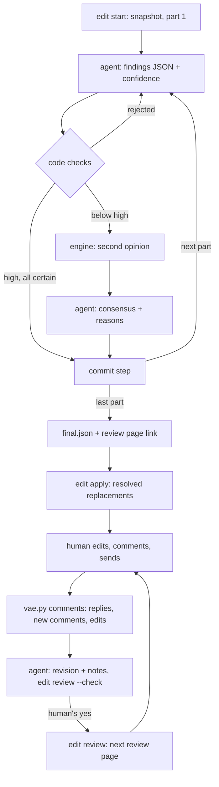

# Edit runs: anchored review, apply, review page

`doc` and `doc-edit` review a page through `vae.py edit`. Each finding is JSON tied to an exact quote of the page, code checks every answer before it counts, a run folder records every accepted part, and `edit apply` writes only the replacements the review resolved. This page holds what the skills leave out.

## Why this design

It ports pro-edit (the maintainer's editorial review application, which does not ship with the plugin: a Node and Pi SDK program that reviews a Markdown document part by part with a configured model) to the plugin's stdlib Python. pro-edit's value is what its code enforces:
- strict JSON;
- quotes that must exist inside the reviewed part;
- no replacement while a factual question is open;
- protected terms;
- a rolling memory anchored to source quotes, and an audit that must cite visible originals;
- bounded corrective retries;
- step files as the only accepted state.

`VERIFIED:` (pro-edit's `output/`, 2026-10-11) 9 of 10 runs on a 98 KB report stopped before the one that succeeded: 7 on three of these checks (inexact quotes, unescaped quotes inside JSON and, in 4 runs, summaries the reducer rejected), one on a timeout and one on the tool-call budget. The prompts then gained rules against these failures.

The window walk, `vae.py prose --walk` up to 0.8.0, printed one window per step but left the findings as free text that nothing checked or recorded. An edit run keeps the program-driven loop and makes each answer checkable.

`VERIFIED:` (`tests/test_edit.py`) on pro-edit's recorded example run, the port reproduces the parts with their UTF-16 offsets, every review input, every memory step byte for byte, and `summary.md`. `VERIFIED:` (probe, 2026-10-12) the stdlib schema validator gave the same verdict as `jsonschema` 4.23 `Draft202012Validator` on all 3,012 cases: the example run's answers plus 250 random mutations of each. It fails closed on any keyword it does not implement.

## The loop

1. **Start.** `vae.py edit --repo . start <page> --model <id>` snapshots the page into `tmp/vae/edit/<page>-<stamp>-<hex>/`. It prints the contract (`references/edit/CONTRACT.md`) once, then part 1. The window holds the previous part as context and the part to review with line numbers; only the review part supplies quotes.
2. **Submit.** `edit submit --run <run> --part N --findings <file> --confidence high|medium|low` checks the JSON and prints the next part, or the reason and the same window again.
3. **Second opinion.** Where the agent is unsure, a second model reviews the part too: the engine, set up under [Configuration](#configuration). Unsure means the agent rated the part `medium` or `low`, or marked an issue `sicherheit: mittel`. The engine sees the same window with an empty memory, since an agent run keeps none, and the command pairs both finding sets by overlapping quotes. The agent then submits the consensus with `--decisions`: one `{source, index, keep, reason}` per finding only one reviewer raised. The code checks that kept findings appear in the consensus, dropped ones do not, and every pair survives. Without `.vae/.env.openai.json` the agent's findings stand, and the command says so.
4. **Finish.** After the last part the run writes `summary.md`, the review page and, last, `final.json`, and prints the page's link (see Review page).
5. **Apply.** `edit apply --run <run>` refuses when the page changed after the snapshot, since its hash must equal `documentId`. It then replaces each resolved quote from the end of the page backwards, in one atomic write, and records `applied.json`. A finding without a replacement stays open: the agent settles it from repository evidence or asks the human.

**Why the agent reviews first.** The harness agent already has the page, the repository and the conversation in context, so its review needs no second model. The engine is a second model with another view, so it runs where the agent is unsure. The disagreements are written down with reasons.

`HYPOTHESIS:` this catches more real problems per token than a second full review of every part; falsifier: parts the agent rated `high` that a later full engine run finds material problems in.

**Engine run.** `edit start <page> --engine` runs pro-edit's whole pipeline on the configured model. Each part gets a review, a summary delta and an audit, all on the memory as it stood before that part. A persistent audit disagreement is committed and marked with `auditOverride`, while a mechanical failure stops the run with `failure.json`; `edit resume --run <run>` continues it.

`VERIFIED:` (pro-edit runs) 6 minutes for the 574-byte example. For the 98 KB report: 5 h 47 min, 160 model calls, 20.5 M input and 2.6 M output tokens, on a local model. `VERIFIED:` (2026-10-12, `glm-5.3` on z.ai) the same example took 19.3 min and 266,000 tokens, and raised 3 findings, each matching one of pro-edit's recorded run, and none of its 3 heading or 3 other findings. `VERIFIED:` (2026-10-13, 3 runs) with thinking off (`"thinking": {"type": "disabled"}` on the role) it took 1.8 to 2.3 min and 105,000 to 119,000 tokens, and raised 1 or 2 of those 3 findings. So the skills start an engine run detached and only when the human asks.

`VERIFIED:` (2026-10-13) pro-edit's recorded run used its full prompts (`prompts/review.md`, `summary.md`, `audit.md`, by the hashes in its `final.json`), while its `pi.config.ts` names the `_short` prompts, about half the size. Every review input of the port's runs matched the recorded one in text, range and guidelines. The memory before part 4 held 1,400 to 1,750 characters with either prompt set, against 6,098 in the recorded run, so its size comes from the model. With pro-edit's full prompts swapped in unchanged, thinking off matched 3, 3 and 5 of the 9 recorded findings in 1.5 to 2.3 min, against 1, 2 and 2 with the `_short` prompts. Routed per [Thinking per part](#thinking-per-part) at `reasoning_effort` `high`, they matched 6 of 9 in 6.6 min, every finding a match, against 4 of 9 in 7.0 min. So the port ships the full prompts. Adapted and run through `edit start --engine` three times, three runs at a time, they matched 6, 4 and 5 of 9 in 6.2 to 11.0 min, every finding a match and every comment in German. `UNKNOWN:` whether the full prompts find more beyond this example's 4 parts.

## Thinking per part

With a model role `editor-thinking` in `.vae/.env.openai.json` and a decision model in `.vae/.env.typed-decisions.json`, the engine picks the reviewer per part:
- The decision model scores the part's text from 0 (plain: headings, short simple statements) to 2 (claims, numbers, qualifications, exceptions or conclusions that depend on each other).
- A part scored at or above `thinking_score` (1.0) goes to `editor-thinking`; any other part, and a part without a score, goes to `editor`.
- A thinking review that fails (time or turn budget, rejected answers) is repeated by `editor`.
- Summary and audit always use `editor`.

Each step and second opinion records the choice as `route`: the role, the score and the reason for a fallback.

`VERIFIED:` (probe, 2026-10-13, `glm-5.3` on z.ai, the `_short` prompts) each part was reviewed once per role as a second opinion, four reviews at a time. `low`, `high` and `max` are `editor-thinking` at that `reasoning_effort`; z.ai's default is `max`. The reference is pro-edit's recorded run for its example and the agent's review of this page for `EDIT.md` (snapshot of 2026-10-12). Each cell gives the reference findings the review matched and its time.

| Part | Score | `editor` | `low` | `high` | `max` |
|---|---|---|---|---|---|
| example 1 | 0.00 | 0 of 1, 10 s | 0 of 1, 5 s | 0 of 1, 24 s | 0 of 1, 23 s |
| example 2 | 1.12 | 0 of 2, 11 s | 1 of 2, 13 s | 1 of 2, 263 s | 1 of 2, 364 s |
| example 3 | 0.22 | 1 of 3, 29 s | 0 of 3, 6 s | 1 of 3, 131 s | 1 of 3, 250 s |
| example 4 | 1.38 | 1 of 3, 22 s | 1 of 3, 7 s | 2 of 3, 108 s | 2 of 3, 84 s |
| `EDIT.md` 1 | 1.05 | 0 of 0, 8 s | 0 of 0, 6 s | 0 of 0, 167 s | 0 of 0, 78 s |
| `EDIT.md` 2 | 2.00 | 1 of 3, 47 s | 1 of 3, 65 s | 1 of 3, 319 s | 3 of 3, 491 s |
| `EDIT.md` 3 | 2.00 | 0 of 2, 24 s | 1 of 2, 40 s | over 600 s | over 600 s; run alone: 0 of 2, 1,784 s |
| `EDIT.md` 4 | 1.96 | 0 of 2, 30 s | 0 of 2, 176 s | over 600 s | over 600 s |
| `EDIT.md` 5 | 0.73 | 0 of 1, 8 s | 0 of 1, 34 s | over 600 s | over 600 s; run alone: 1 of 1, 1,116 s |
| `EDIT.md` 6 | 1.60 | 0 of 1, 33 s | 0 of 1, 20 s | over 600 s | turn budget exceeded |
| `EDIT.md` 7 | 2.00 | 0 of 1, 29 s | 0 of 1, 12 s | 0 of 1, 405 s | 0 of 1, 562 s |

Within 600 s, `max` matched more than `editor` on three parts, all scored 1.12 or higher, and the same on the two parts scored 0.0 and 0.22. Run alone without that limit, it matched the reference on `EDIT.md` 5 (score 0.73) after 18.6 minutes and 78,900 reasoning tokens, and nothing on `EDIT.md` 3 after 30 minutes and 122,500. So `timeout_s` stays 600 and a failed thinking review falls back: a longer limit buys an uncertain finding at up to 140 times the time of `editor`. The deadline is checked between model turns, so one turn can outlast it; a `max_tokens` near 65536 on `editor-thinking` bounds that turn.

The effort trades findings for time, without a level that keeps both:
- `low` thought briefly (20,600 reasoning tokens over all 11 parts, against 97,000 at `high` and 126,000 at `max`) and matched 4 in 386 s, close to `editor`'s 3 in 250 s.
- `high` matched 5, `max` 7; both ran over 600 s on the same 4 parts. On the 5 routed parts both finished, `high` took 1,262 s against 1,579 s and matched 4 against 6.
- Routed engine runs on the example matched 2 and 1 of 9 in 2.4 and 2.3 min at `low`, and 4 of 9 in 7.0 min at `high`.

`HYPOTHESIS:` within `timeout_s`, the threshold of 1.0 separates beyond these 11 parts; falsifier: a step routed to `editor` with a score below 1.0 where a thinking review that ends within `timeout_s` finds a material problem that `editor` missed.

## Output language

pro-edit's prompts are German, and each prompt here says to write in the language of the document text. With a decision model in `.vae/.env.typed-decisions.json`, the engine also asks it once per run which of 12 languages the page is written in, judged on its first 4,000 characters: English, Chinese, Hindi, Spanish, French, Arabic, Bengali, Portuguese, Russian, Urdu, Indonesian or German. When the answer reaches the decision model's `threshold`, every prompt (review, summary, audit, second opinion) ends with `Output language: <language>`. Otherwise, and for a page in another language, the prompts' own rule stands. Each step and second opinion records the answer as `language`.

`VERIFIED:` (probe, 2026-10-13) without that line, `editor` wrote all 5 of its comments on this English page in German, and `editor-thinking` 2 of 5. With it, the decision model named English for this page and German for pro-edit's example, both at confidence 1.0. `editor` then wrote all 4 of its comments on this page in English, and each of 7 engine runs on the example wrote all its comments, 2 to 9 per run, in German.

## Contract and evidence

Findings use pro-edit's schema (`references/edit/review.json`, byte-identical) with German key names, so its readers stay compatible. Comments follow the page's language. At load time the schema gains:
- the catalog's 61 rule IDs, adding P09, T07, A09, A10 and R09 to pro-edit's 56;
- pro-edit's runtime document evidence (`quelle: dokument`);
- file evidence (`quelle: datei`, a repository path).

`$id` ends in `:document-evidence:vae`.

Evidence is internal: the page, the repository's files and local attachments. The repository's files are those git tracks or would track, never a `.env*` file. Attachments are local PDFs, Office files and images, read through the capability router. Editing never gathers external information: web, paper and GitHub search belong to the research skill, and an edit starts a research run only when the human asks for or confirms one. A claim only an outside source could settle gets `belegen` or `pruefen`, no replacement, and a question.

The engine's tools are read-only:
- `document_read` and `document_grep`: for the review the parts up to and including the current one (every part with `tool_scope: document`), for the summary and the audit the window of the previous and the current part;
- for the review, also `file_grep`, `file_read` and `inspect_file`.

A corrective retry cannot keep `hoch` by deleting evidence or by moving the issue to another rule. pro-edit treats an issue without `belege` as visible in its quote alone, so an issue rejected as summary-only at `hoch` passes once its evidence is gone. The port remembers, per part, every issue of every rejected answer: its rule, its quote span and whether it cited evidence. An issue at `hoch` without evidence is rejected when a rejected answer cited evidence on an overlapping quote:
- under the same rule;
- under another rule, when that answer had no issue of this rule there and the cited rule has no evidence there now.

The agent's submissions follow the same rules through `steps/NNNN.rejected.json`. `VERIFIED:` (traces of 7 engine runs on pro-edit's example, 2026-10-13) one run deleted evidence: after two rejections, L01 came back at `hoch` without its memory quote, and the comment lost the sentence that rested on the memory. `VERIFIED:` (replay, 2026-10-14) over the 57 reviews traced in 15 runs, 11 of them with retries, both rules reject only that answer. The rules cannot tell a gamed rule change from an honest one: a model that rethinks a rejected issue as a local problem under a new rule must also cite evidence or set `mittel`.

The decision model checks whether evidence supports its comment. For each issue with evidence, at either `sicherheit`, the engine and `edit submit` ask whether the cited evidence supports the comment's claim about the quoted text; the state is the quote, the comment and the evidence. A sure `no` sends the answer back, and its evidence then binds the retry as above. The step's `support` records each answer. When the decision model fails, the answer stands and `support` records the error, because a decision endpoint that is down would otherwise stop every run. `VERIFIED:` (probe, 2026-10-14, threshold 0.7) on 38 issues with evidence from the probe runs and pro-edit's recorded run:
- evidence swapped for an unrelated sentence of the same page got a sure `no` 24 times; of the 14 swaps it let pass, 2 were sentences the claim rests on;
- the real evidence got a sure `no` 3 times, each citing the page's note that it describes a constructed test case, for a comment about another claim;
- asked whether a comment fits its rule, the model said a sure `no` to a random rule from another group 13 times and a sure `yes` 8 times.

That question did not tell right rules from wrong ones, so the rule change stays a deterministic check. `HYPOTHESIS:` the catalog's rules overlap, so a comment often fits a second rule too.

`VERIFIED:` (run folders, 2026-10-14) the 15 recorded runs kept 0 to 4 issues with evidence each, so a run asks about that many questions, plus those for answers sent back.

Its prompts are pro-edit's full prompts (`references/edit/review.md`, `summary.md`, `audit.md`), the ones its recorded run used, changed only where they demanded German output; the review also gains the catalog's rules P09 and T07. Instruction language does not set output language, so each prompt says to write in the language of the document text.

## Files

| File | Content |
|---|---|
| `source.md` | the page's exact bytes at the start |
| `parts.json` | pro-edit's parts: id, UTF-16 `start`/`end`, line, headings, text |
| `run.json` | ours: page path, mode (`harness` or `engine`), model, settings |
| `steps/NNNN.json` | pro-edit's step: `customInput`, `custom` (the findings), memory, delta, audit, calls; ours: `route`, `support`, `language` |
| `steps/NNNN.opinion.json` | the agent's and the engine's findings, the pairs, the decisions, the engine's `route`, `support` and `language` |
| `steps/NNNN.trace.jsonl` | every model request as sent and its reply, without headers, mode 600 |
| `steps/NNNN.rejected.json` | rule, quote span and evidence flag of each issue of each rejected agent submission |
| `summary.md` | the rolling memory as text (empty in an agent run) |
| `final.json` | pro-edit's completion marker, written last |
| `failure.json` | an engine run's error; `edit resume` continues from the last step |
| `draft/` | the agent's findings files, one per submission |
| `applied.json` | what `edit apply` replaced and what it skipped, with the reason |

`doctor --tidy --apply` removes a run folder untouched for 14 days, traces included. The review page lives apart from the run, in its review folder:

| File in `.vae/doc-reviews/<page>-<revision>-<sha8>/` | Content |
|---|---|
| `index.html` | the review page |
| `source.md` | the reviewed bytes, so a response still reads back after the run is tidied |
| `doc.json` | page, revision, `documentId`, and the run or the `previous` review folder |
| `response.json` | the human's response, written by "Send to agent" |
| `base.md` | the page when the agent first read the response, which the next revision is checked against |

## Review page

Each finished review gets a folder `.vae/doc-reviews/<page name>-<revision>-<sha8>/`. The revision counts the reviews of that page, and `sha8` begins the SHA-256 of the reviewed bytes. The folder ignores itself through its own `.gitignore`, and `doctor --tidy` leaves it alone, so the review history stays local and outlives the run. The run's steps and traces stay in `tmp/vae/edit/`, so the server below never serves them.

The CLI prints the page's link, `http://127.0.0.1:<port>/<token>/<folder>/`. One review server per repository serves `.vae/doc-reviews/`: Python's standard `http.server`, bound to 127.0.0.1. The first finished review starts it, detached from the CLI and the shell. Later reviews reuse it, and a restart takes the previous port and token, so earlier links keep working. `edit serve` prints its address, and `edit serve --stop` stops it. Its pid, port and token sit in `tmp/vae/review-server.json` (mode 600), and its log in `tmp/vae/review-server.log`. A server whose folder is gone ends itself. When the server cannot start, the CLI prints the file's path and `UNKNOWN[review-server]`.

The page is defuss-shadcn's Document Editor scaffold (0.9.9): the page in Editor.js, the findings as cards in the comment column, coloured by severity. The human edits the text, replies under a card, selects text to add a comment, and clicks "Send to agent", which saves `response.json` into the folder. "Download" saves the same JSON as a file. `vae.py comments <folder> --repo .` prints each reply and new comment with its page line, and the text edits as diff hunks headed by their page line. The page keeps comments and edits in the browser's local storage, so a reload loses neither. A switch in the header sets light or dark mode for that browser.

Beside each card's Reply, the Accept and Reject buttons answer it in one click. Each adds a reply that carries `verdict`; a card holds one, the other button replaces it, and clicking the same button again takes it back. A card whose replacement `edit apply` wrote is dashed. `vae.py comments` prints a verdict as `ACCEPT` or `REJECT` with what it asks of the agent:

| Card | Accept | Reject |
|---|---|---|
| applied (dashed) | keep it | restore the original text |
| held back by the meaning check | apply its replacement | leave the text |
| open: a question, no replacement | do what it proposes | leave the text |

An applied card that got no reply at all prints under `ACCEPTED` and stays. The human saw it dashed as done, so silence keeps it, and an objection takes one click. Asking for a click on every applied card would make a review with 20 rewrites 20 clicks longer and change nothing. `VERIFIED:` (`tests/site/e2e.mjs`, 2026-10-18) the applied card is dashed and the open one is not; Accept then Reject leaves Reject, and Accept twice leaves none; the CLI reads the Reject back as `REJECT … → leave the text as it is`; the verdict and the dark mode survive a reload. A research run writes `report.html` the same way, read-only and opened from disk.

Edits travel as a diff. Editor.js writes every block in its own Markdown style and drops what it cannot represent, such as underline. The response therefore holds the editor's Markdown of the page as loaded (`baseline`) beside the edited one, and only their difference is an edit. The agent carries each hunk into the page in the page's own style. `VERIFIED:` (`tests/site/e2e.mjs`, 2026-10-14) one edited sentence in a page with a heading, a table and a code block came back as exactly one hunk, at its page line.

The page also stores an edit on every `input` event. `VERIFIED:` (probe, 2026-10-14) Editor.js reported typing more than a second late, and a reload in that time lost the edit.

The server refuses what the page itself would not send:
- **No token:** every path lies below `/<token>/`, a random value that only the user's own files hold. Other users of the machine reach 127.0.0.1 too, so the link works as a capability for reading and sending. The token reaches the server through its environment, which other users cannot read, unlike its command line.
- **A foreign `Host`:** a site that a DNS rebinding points at 127.0.0.1 arrives with its own name as `Host`.
- **A POST from elsewhere:** a POST must carry the server's own `Origin` and `Content-Type: application/json`, target `<folder>/response.json` of a folder with `doc.json`, and hold at most 16 MiB of JSON with `vae.kind` `edit`. A cross-site form cannot send JSON, and a cross-site fetch of JSON needs a preflight this server never grants.

`VERIFIED:` (probe, 2026-10-12) a page opened from disk in Chrome loaded the pinned builds from jsDelivr and placed all 9 comments of the example run on their text, with no console error. `tests/site/e2e.mjs` drives the served page on every `make e2e`: link, edit, reply, comment, send, download, reload. The page needs the network for its builds.

## Next revision

After the human sends the response, the agent writes the next revision of the page and offers the next review page. That page goes into a new review folder of the same page, one revision up.

1. `vae.py comments <folder> --repo .` prints the replies, new comments and edits. The first time, it also saves the page as it is then into the folder as `base.md`.
2. The agent changes only what a reply, a verdict, a new comment, a text edit or the human's chat proposes or accepts. Everything else stays as in `base.md`, applied findings that nobody answered included. A finding the agent would add, or a question a reply leaves open, becomes a note, not a page change or a chat question.
3. The agent writes the notes as one JSON array of `{on, quote, body}`, one note per change, answer or question. `on` names what asked for the change: a comment id from the read-back, `edits`, or `chat` together with `said`, the human's words there. A note that changes nothing has `on: null`. `quote` is exact text of the page as it is now.
4. `vae.py edit --repo . review <folder> --notes <file> --check` compares the page with `base.md` word by word. It refuses every change that no note's quote covers, unless `on` names what asked for it. Then it prints `VERIFIED[revision]`, and the agent offers the next review page.
5. When the human says yes, the same command without `--check` writes the folder: the page as it is now, with each note as a comment. Above each comment stand the human's words it answers. Where the quote changed, the text before follows the comment, and the card is dashed as applied: the same verdicts and the same silence apply to it. The CLI prints the link, and the loop starts again.

The code checks this, because the agent's word is not enough. `VERIFIED:` (2026-10-15) the first revision of this page relabelled an arrow in the diagram that no comment asked for, and the check refuses such a change. It compares words, not lines, because a paragraph is one line of Markdown: a line diff would let a note on one sentence cover every other change in that paragraph. Each added word must lie inside a quote and each removal must happen inside one, since two neighbouring changes can merge into one diff span that no single quote covers. A `chat` note carries `said` because the code cannot see the chat, so the human checks the quote on the page. The check also cannot tell who made a change. When the agent did not make a change, such as the human's own edit in their editor, it tells the human and does not undo the change.

Both commands take the page path from the folder's `doc.json`, which only the CLI writes. They never take it from the response, because the page uploads the response, and a path there could name any file.

## Configuration

`.vae/VERIFY.py` `CONFIG["prose"]`:
- **`guidelines`** (pro-edit's `vorgaben`): `textsorte`, `zielgruppe`, `kommunikationsziel`, `hausstil`, and `geschuetzte_begriffe`, the terms a replacement must keep.
- **`edit`**, defaults in parentheses: `max_part_chars` (8000), `heading_depth` (2), `audit` (true), `attempts` (4), `timeout_s` (600), `max_input_chars` (800000), `max_memory_chars` (600000), `max_turns` (12), `max_tool_calls` (32), `tool_scope` (`prefix`), `trace` (true), `max_tokens_total` (none: no spending ceiling), `thinking_score` (1.0).

The engine uses the `editor` role of `.vae/.env.openai.json`, else `reasoner`, and `editor-thinking` per [Thinking per part](#thinking-per-part). A model that thinks by default needs thinking switched off on `editor`; for z.ai that is `"thinking": {"type": "disabled"}`. On `editor-thinking`, z.ai's `reasoning_effort` (`low`, `high` or `max`, the default) sets how long it thinks; [Thinking per part](#thinking-per-part) shows what each level found.

When `.vae/.env.typed-decisions.json` exists, `edit apply` asks it about each replacement that must keep the meaning, those of `umformulieren`, `kuerzen` and `umstrukturieren`: does it say the same as the original? A replacement it judges a meaning change with confidence at or above its `threshold` stays open, and so does one whose check fails. A correction (`revidieren`) or a precision (`praezisieren`) changes the content by design and is not asked about. `VERIFIED:` (2026-10-12, a review of this page) asked about every replacement, the check held back all 10, corrections included, at `no` 0.82 to 1.00; asked only about the rephrasings, it held back one that also added a version number.

`VERIFIED:` (2026-10-12, `jev-latest`, threshold 0.7, 12 cases) all 7 meaning changes got `no` at 0.86 to 1.0: a dropped negation, a changed number, a hardened modal, widened scope, an overstated count, a dropped attribution and a dropped quantifier. Of 5 meaning-preserving replacements, 4 got `yes` at 0.42 to 0.88 and one got `no` at 0.22. Applying only on a confident `yes` would have kept 2 of the 5; holding back only a confident `no` kept all 5 and stopped all 7.

`HYPOTHESIS:` this asymmetry holds beyond these 12 cases; falsifier: in `applied.json`, an applied meaning change or a held-back replacement that keeps the meaning.
