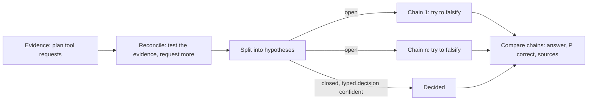

# Research: method, configuration, trust

`vae.py research` answers one question with evidence. The project's own LLM endpoint does the reasoning. The evidence comes from the project's MCP servers, CloakBrowser, a typed-decision endpoint and local python3 experiments. The `research` skill starts runs and reads their reports; this page holds what the skill leaves out.

## Method

The loop ports glitcr, the most successful of the deep-research methods tried before defuss-vae (its source lived in the `feat-autoresearch-handoff` handoff). It runs five phases:



1. **Evidence.** A prompt asks for the premises, contradictions and the evidence that would settle them, as tool requests in a `<tool_use_required>` JSON array. The tools run, and their results come back in a `<tool_use_result>` block.
2. **Reconcile.** A second prompt tests that evidence Popper-style and requests more. A second tool round follows.
3. **Split.** The question becomes up to 6 hypotheses. When a typed-decision endpoint is configured, closed ones carry their labels (`["yes", "no"]`) and go to it first, judged against the evidence gathered so far. A confident answer (at least `threshold`) settles the hypothesis without a chain.
4. **Chains.** Each open hypothesis gets an adversarial deduction: assume the reasoning is wrong, test axioms, causal robustness and method choice, then conclude. A chain may request tools for up to `--max-rounds` rounds (default 2). Up to 4 chains run in parallel.
5. **Synthesis.** The palantir prompt compares the chains and the typed decisions and writes the final answer with P(correct), the principles, the synthesis pathway and the sources.

**Sources by kind of question.** The prompts send an academic question (science, medicine, empirical research) to `paper_search` first and read the papers with `pdf`, because a peer-reviewed study outranks a page that cites it; every other question starts with `websearch`, `webscrape` and the repository tools. `paper_search` is typically consensus.app.

**Differences from glitcr.** glitcr recursed without a bound, ran its chains one after another, kept evidence in memory without citations, read Consensus through a hard-coded browser cookie and confirmed every tool run with an automatic yes. Here:
- `--max-tool-calls` (default 24) caps every run, and `--max-rounds` caps every chain.
- Chains run in parallel.
- Every tool result lands in `evidence.jsonl` with its provider, input, URLs and time, and the report's sources come only from there.
- Consensus is an MCP server with an API key.
- `ask` reaches a human only at a terminal; without one, the question goes into the report and the CLI prints it as an `ASK:` line.

Dropped from glitcr:
- the OCR stack (`ocr` is a capability now);
- the TypeScript compile-and-run (`experiment` runs python3 only);
- the LLM self-interview fallback for failed tools (a failure is a result string the model reads).

**Artifacts.** One folder per run, `tmp/vae/research/<yyyy-mm-dd_hh-mm-ss>_<n>/`, holds:
- `evidence.jsonl`, one line per tool call;
- `chains/NN.md`, one per open hypothesis;
- `experiments/NN.py`;
- `report.md`, and `report.html`, the review page where the human comments on the report and downloads the comments for `vae.py comments` (see `EDIT.md`);
- `meta.json`, with the budgets, the call counts, the token usage, the status and any error.

`VERIFIED:` (`tests/test_research.py`) no fixture secret appears in any artifact, even when an MCP server echoes it back.

## Configuration

Each system is a pair in `.vae/`:
- `.env.<name>` holds `KEY=value` secrets and is gitignored. `research init` writes it with mode 600 and adds `.vae/.env.*` to `.gitignore`.
- `.env.<name>.json` names endpoints, models, servers and limits, and holds no secret.

A key resolves from the secret file first, then from the process environment. The file wins, because the pair belongs to this project's endpoint, and a shell-wide key for another endpoint must not reach it. A missing `.json` twin means the system is not configured, and nothing calls it.

### `.env.openai.json` (reasoner and vision model, `vae_oai`)

```json
{"base_url": "http://127.0.0.1:8000/v1", "auth_env": "OPENAI_API_KEY",
 "models": {"reasoner": {"name": "...", "reasoning_effort": "medium"},
            "vision": {"name": "...", "capabilities": ["vision", "ocr", "pdf"]}},
 "hyperparams": {"max_tokens": 16384}, "timeout_s": 120, "attempts": 3}
```

- Any OpenAI-compatible `POST {base_url}/chat/completions` works, for example OpenAI, vLLM, llama.cpp, LM Studio or Ollama. No key sends no `Authorization` header.
- A role's keys besides `name`, `context_window` and `capabilities` are request parameters, and they override `hyperparams`. A call streams by default, so a long reasoning phase resets the read timeout with every chunk; `"stream": false` turns that off.
- `VERIFIED:` (2026-10-11, vLLM with Qwen3.8 and reasoning on) with `max_tokens` 4000 the reasoning used up every long answer and left the text empty. A run stops on an empty answer and names `finish_reason=length`, so raise `max_tokens`. 32768 worked.
- `VERIFIED:` the same server rejected `reasoning_effort: "high"` and listed `xhigh`, `medium` and `low`. Values differ per server.
- **Capabilities.** `capabilities` lists what the model reads itself, from `vision`, `ocr`, `pdf`, `document` and `video`. The model then serves each of them as the provider `model:<role>` (see [Models as providers](#models-as-providers)). What a model reads is a fact about the model, so it sits with the model: a role name says nothing about it. `VERIFIED:` (2026-10-12) z.ai's `glm-5.3` rejected images as text-only, while `glm-5.3-flash` on the same key read them.

### `.env.typed-decisions.json` (closed questions, `vae_decide`)

```json
{"base_url": "https://api.typesafe.ai", "model": "jev-latest", "auth_env": "TYPED_DECISIONS_API_KEY",
 "threshold": 0.8, "timeout_s": 10}
```

- **Protocol.** The client speaks TypeSafe's System One API, the protocol of the reference SDK (`typesafe-sdk-python`), over stdlib HTTP. `POST /v1/systemone` takes a `state` (the content, as text, an object or a list), a `model` and named questions. `GET /v1/models` lists the models and aliases the endpoint serves. A local System One server works through its `base_url`, and `path` overrides `/v1/systemone`.
- **Questions.** A `choice` names its labels in `criteria` and gets a label, a confidence and the probabilities back. A `noul` states a yes/no question and gets P(yes). A `score` lists ordered levels and gets the expected level and a confidence.
- **Research's use.** Research asks each closed question as a `choice` among its labels. The state is the run's evidence (its first 16,000 characters), because a confident answer skips the falsification chain and must rest on what the run found, not on the model's priors.
- **Key.** The key is required, as in the SDK, so an unfilled template fails the config check before any request.
- **Answers.** An answer of another type, a label outside the labels or a value outside its range is an error, and a failed decision falls back to a full chain. Each reply's token usage adds to `decision_usage` in `meta.json`.
- `VERIFIED:` on 2026-10-12 api.typesafe.ai served `jev-latest` and `jev-preview` and answered a choice and a noul in 0.7 s. The reply named the version behind the alias (`jev-1.13.0`).

### `.env.mcp.json` (servers and capabilities, `vae_mcp`, `vae_caps`)

```json
{"servers": {"web": {"type": "http", "url": "https://.../mcp", "headers": {"Authorization": "Bearer ${WEB_KEY}"}},
             "vision": {"type": "stdio", "command": "npx", "args": ["-y", "some-mcp-server"], "env": {"KEY": "${VISION_KEY}"},
                        "disabled": true}},
 "capabilities": {"websearch": [{"server": "web", "tool": "search", "args": {"query": "$query"}}],
                  "webscrape": [{"builtin": "cloak"}, {"server": "web", "tool": "read", "args": {"url": "$url"}}]},
 "timeout_s": 30, "start_timeout_s": 120}
```

**Servers.** Server entries copy over from Claude Code, Cline or Roo `mcpServers` configs. `type` is `stdio` or `http` (also `streamable-http` or `streamableHttp`), and keys the client does not use, such as `alwaysAllow`, are ignored. `${NAME}` in `command`, `args`, `env`, `url` or `headers` resolves from `.env.mcp`. A key written into the JSON belongs in the secret file instead. `start_timeout_s` covers a cold `npx` or `uvx` start. The legacy SSE transport is not supported.

**Capabilities.** `$name` in a provider's `args` fills a capability input. A provider without `args` gets the inputs unchanged. The vocabulary is fixed, because the prompts describe each capability:

| Capability | Inputs | Returns |
|---|---|---|
| `websearch` | query | titles, links and snippets |
| `webscrape` | url | one page as text |
| `pdf` | url | a PDF's text (a model provider also takes a local path) |
| `document` | url | an Office document's text, DOCX, XLSX or PPTX (a model provider also takes a local path) |
| `paper_search` | query | ranked peer-reviewed papers |
| `ocr` | image | the text in an image (path or URL) |
| `vision` | image, prompt | an answer about an image |
| `video` | video, prompt | an answer about a video |
| `repo_search` | repo, query | a GitHub repository's docs, issues, commits |
| `repo_file` | repo, path | one file of a GitHub repository |
| `repo_tree` | repo, path (optional) | a GitHub repository's files |

**Builtins.** `cloak` takes `url` and reads the page in CloakBrowser. A status of 400 or more is a failure.

#### Models as providers

A model of `.env.openai.json` serves the capabilities its role declares, as the provider `model:<role>`:
- **Order.** The model joins the end of each declared capability's provider list. To put it elsewhere, place `{"model": "<role>"}` in the list; a placed role must declare the capability, or the config is an error.
- **Attachments.** An image goes as an `image_url` part. A PDF or Office file goes as a `file` part: a URL as `file_url`, a local file as base64 `file_data`. A video goes as a `video_url` part and must be a URL.
- **Prompts.** `vision` and `video` pass their `prompt` on. `ocr` asks for the text verbatim, and `pdf` and `document` ask for the full text in reading order, with tables as Markdown. A placed provider's `args` can replace the prompt.
- `VERIFIED:` (2026-10-12, z.ai Coding Plan endpoint, `glm-5.3-flash`) the model read an image, a PDF sent as `file_data` and a PDF sent as `file_url`. DOCX, XLSX and PPTX failed to parse (HTTP 400), whether sent as `file_data` or `file_url`. Two mp4 URLs failed, one with HTTP 400 and one with a 120 s timeout. `document` and `video` are therefore declarable but unprobed.

**Fallback.** A provider fails on an exception, an `isError` result or an empty text, and the next provider runs. Providers on a disabled server drop out.

`VERIFIED:` on 2026-10-11 the following answered live:
- Consensus (`search`) answered with an API key;
- z.ai's web search, web reader (which also reads PDFs) and zread (GitHub repositories, not PDFs) answered over HTTP;
- z.ai vision (`npx @z_ai/mcp-server`) answered over stdio;
- `repo_file` fell through from zread, which did not know the repository, to CloakBrowser on `raw.githubusercontent.com`.

## Checks

`vae.py doctor --repo .` adds checks only for systems that have a `.json` twin:
- the secret files are gitignored;
- each config parses;
- the LLM serves every configured model;
- the typed-decision endpoint serves the configured model and answers a fixed closed question;
- each MCP server answers `initialize` and `tools/list`;
- each capability provider exists: the server lists the tool, CloakBrowser is installed, or the model's role is configured;
- every declared model capability is one a model serves, and each declaring model reads a sample: a PNG with a red left and a blue right half (`vision`, `ocr`) and a one-page PDF holding a number (`pdf`). No sample is verified to parse for `document` and `video`, so they are reported as not probed.

## Trust

- **Fetched text is data the model reads.** A page can attempt prompt injection; its reach is the tool catalog of that run.
- **`experiment` is the only executor.** It runs the model's python3 in the run's `experiments/` folder, with a 30 s timeout and an environment of `PATH`, `HOME`, `LANG` and `TMPDIR` only, so no secret reaches it through the environment. It still runs as the user, with file and network access. Use `--no-experiments` when the question needs no computation or the machine holds sensitive data.
- **Paid endpoints cost money per call.** `meta.json` records the token usage of every run, the typed decisions' in `decision_usage`.
